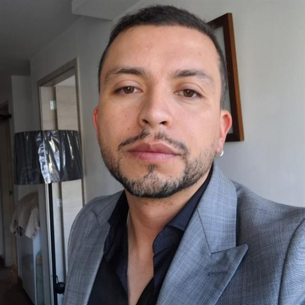

::: {.profile-header}
{.profile-photo fig-alt="Portrait of William E. Echeverría Tigse"}

<!-- Raw HTML H1: a Markdown "#" heading would wrap the rest of the header in a styled section. -->
```{=html}
<h1 class="profile-name">William E. Echeverría Tigse</h1>
```

[PhD researcher in Economics and Finance, University of Coimbra & University of Minho · Researcher at CeBER]{.profile-role}

[Financialisation · International political economy · Innovation · Elite studies · Dollarisation · Econometrics · Geometric data analysis]{.profile-areas}

::: {.profile-links}
[[]{.bi .bi-envelope aria-hidden="true"} Email](mailto:echeverriatigse@uc.pt){.btn .btn-outline-primary}
[[]{.bi .bi-file-earmark-text aria-hidden="true"} CV](files/cv.pdf){.btn .btn-outline-primary}
[[]{.bi .bi-mortarboard aria-hidden="true"} Google Scholar](https://scholar.google.com/citations?user=X_U8qbwAAAAJ){.btn .btn-outline-primary}
[[]{.icon-wrap aria-hidden="true"} ORCID](https://orcid.org/0000-0003-3152-1012){.btn .btn-outline-primary}
[[]{.bi .bi-linkedin aria-hidden="true"} LinkedIn](https://www.linkedin.com/in/william-echeverr%C3%ADa-299116215/){.btn .btn-outline-primary}
[[]{.bi .bi-github aria-hidden="true"} GitHub](https://github.com/williamecheverriat){.btn .btn-outline-primary}
:::
:::

## Bio

I am a PhD researcher at the [Centre for Business and Economics Research (CeBER)](https://www.uc.pt/en/uid/ceber/),
University of Coimbra, funded by an FCT doctoral studentship. Alongside my research, I teach as an invited assistant
lecturer at the Faculty of Economics (FEUC). I expect to complete the joint PhD in Economics and Finance of the
Universities of Coimbra and Minho in 2029.

My doctoral research asks how financialisation shapes technological change, focusing on the ties between large
asset managers and big tech firms in the United States. I use econometric methods from financial economics and
macroeconomics.

My second line of research asks how elites and economic experts govern the economy through monetary regimes, with a
focus on dollarisation in Ecuador. Here I use prosopography and geometric data analysis. I am a founding member of
the Ecuador national team of the [World Elite Database (WED)](https://worldelitedatabase.org/).

Before coming to Coimbra, I taught economics at Universidad UTE in Quito and worked in Ecuadorian higher education
policy.

On this website you'll find my research, teaching materials and a blog with shorter pieces within and beyond my
research.

## Selected research

- **The subordination of economic expertise: The case of the Ecuadorian dollarization.** Villacís, B., &
  Echeverría, W. *Historical Social Research*, 2025. [Details](research.qmd#publications)
- **Technological Governance in the Age of Asset-Manager Capitalism.** PhD project, 2026.
  [Details](research.qmd#work-in-progress)
- **Financialisation and the intangibles shift in US non-financial corporations.** Work in progress.
  [Details](research.qmd#work-in-progress)

[All research →](research.qmd)
